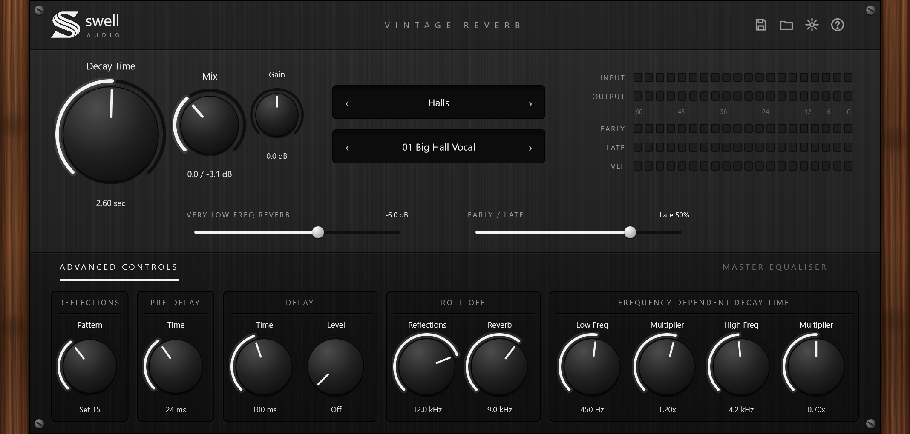

# Swell Reverb — Vintage Reverb 0.1.0

Une réverbération algorithmique stéréo, avec la façade noir et blanc et les joues en bois de la gamme Swell.
Les commandes et le fonctionnement suivent ceux d'une reverb de studio de type « programme + réglages avancés » :
on choisit un espace, puis on l'ajuste.
Fabricant : Swell-audio. Formats : VST3 et Standalone (Windows), plus AU sur Mac.



## Utilisation

1. Choisir une **catégorie** (afficheur du haut) puis un **programme** (afficheur du bas). Les flèches ‹ › font défiler, un clic sur le nom ouvre la liste.
2. Régler **Decay Time** (longueur de la queue, en secondes) et **Mix** (niveaux dry / wet en dB).
3. Affiner si besoin. Charger un programme ne change jamais Mix ni Gain.

| Commande | Rôle |
|---|---|
| Decay Time | RT60 de la queue (0,1 à 30 s). |
| Mix / Gain | Dosage dry / wet, niveau de la reverb. |
| Very Low Freq Reverb | Niveau des très basses fréquences de la queue (-24 à +6 dB). |
| Early / Late | Équilibre entre réflexions précoces et queue. |
| Reflections · Pattern | 40 motifs de réflexions précoces (naturel, groupé, slap, latéral). |
| Pre-Delay | Retard avant l'arrivée de la reverb (0 à 500 ms). |
| Delay · Time / Level | Un écho qui alimente la reverb. |
| Roll-off · Reflections / Reverb | Filtres passe-bas sur les réflexions et sur la queue. |
| Frequency Dependent Decay Time | Les graves (Low Freq × Multiplier) et les aigus (High Freq × Multiplier) durent plus ou moins longtemps que les médiums. |
| Master Equaliser | 4 bandes sur la reverb (grave en plateau, deux en cloche, aigu en plateau) : glisser les points, double-clic pour remettre à 0. |

Vu-mètres : Input, Output, Early, Late, VLF.

## Presets

50 programmes d'usine en 7 catégories : Halls, Rooms, Chambers, Plates, Ambience, Spaces, Vintage
(ressorts, hall numérique années 80, plate lo-fi, batterie « gated »).

Presets perso : la disquette enregistre un fichier `.swellverb`, le dossier recharge.
Ils sont rangés dans `Documents/Swell Audio/Swell Reverb Presets`.

Raccourcis : double-clic sur un bouton = valeur par défaut, Shift + glisser = réglage fin.
La roue crantée change la taille de l'interface (75 à 150 %).

## Moteur

Pré-delay, réflexions précoces lues dans l'historique d'entrée, diffusion par passe-tout,
réseau de 8 lignes à retard (matrice de Householder, modulation lente) avec amortissement sur trois bandes,
queue VLF dosée séparément, filtres de roll-off, puis EQ master. Changement de programme sans clic (fondu de 20 ms).

## Compiler

Windows (Visual Studio 2022 Build Tools + CMake) :

```powershell
./build.ps1
```

Mac : `cmake -S . -B build -DCMAKE_BUILD_TYPE=Release && cmake --build build`.

Les tests (`Tests/AudioTest.cpp`) vérifient les 50 programmes, la stabilité aux réglages extrêmes,
le RT60 mesuré par rapport au Decay, la transparence à Mix 0 et en bypass, le pré-delay, le gate,
la sauvegarde d'état et les presets perso.

by @sevyondatracks
